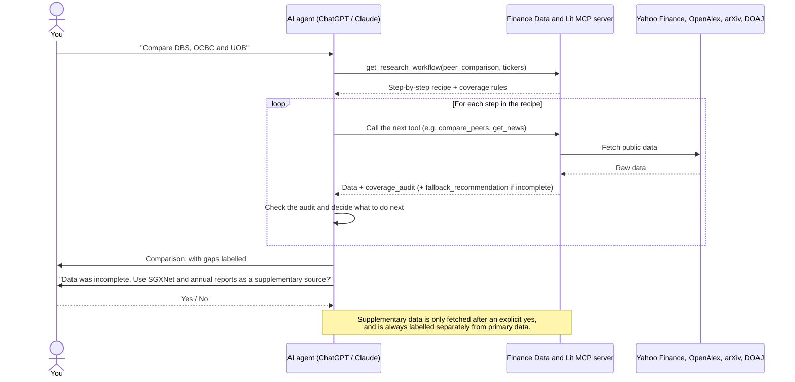
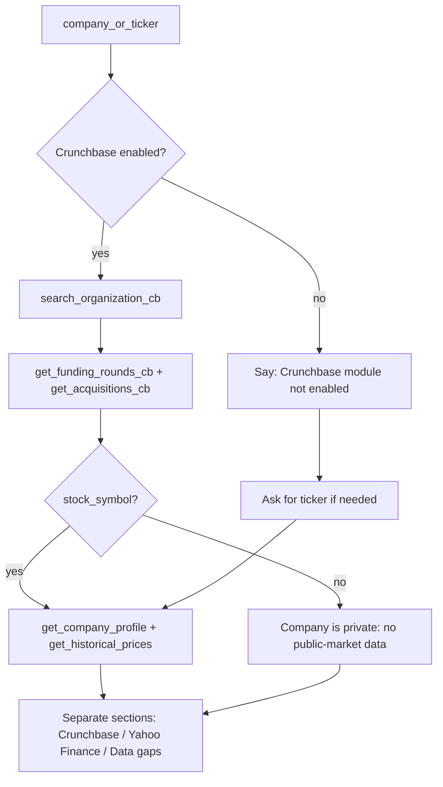
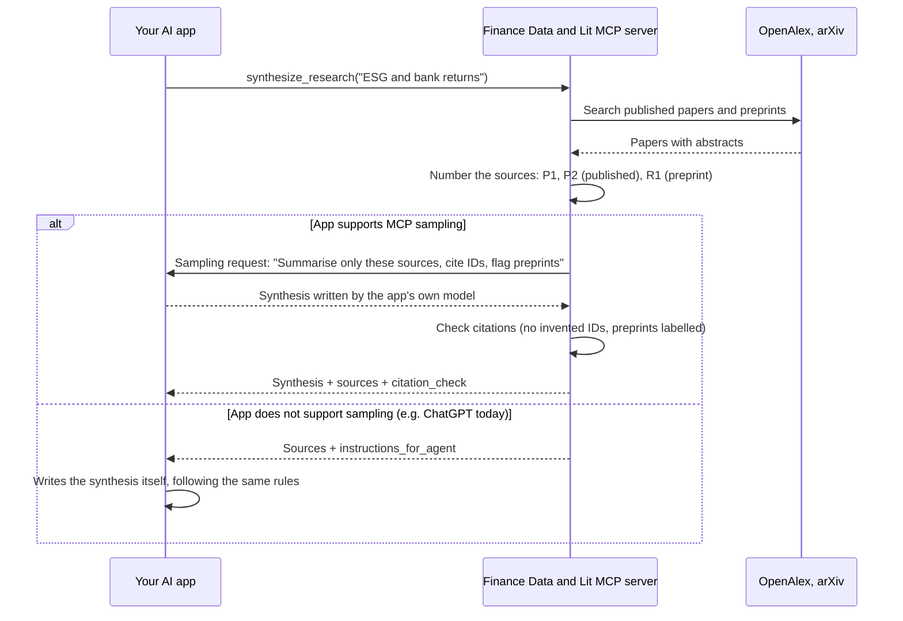

# How the agentic flow works

This server is the tool layer of an agentic research system. It contains no
AI model of its own and **never calls a paid AI API**. The **agent** is the AI
assistant you connect it to (for example ChatGPT or Claude). The server's job
is to give that agent three things:

1. **Tools** that fetch public market data and finance literature.
2. **Recipes** (workflows) that tell the agent which tools to call, in what
   order, for common research tasks.
3. **Guardrails** in every response that tell the agent what data is missing
   and when it must stop and ask you before going further.

The agent supplies the judgment: it decides which tools to use, reads the
results, adapts when something is missing, writes the answer, and asks for
your approval when a guardrail requires it.

> **No AI API costs.** Running this server costs nothing in AI fees. The one
> place where the server asks for AI-written text (`synthesize_research`) uses
> MCP sampling: the request goes to the AI app you are already using, which
> writes the text with its own model. If your app does not support sampling,
> the tool simply returns the sources for your app's AI to summarise.

## Who does what

| | The agent (ChatGPT, Claude, …) | This server |
| --- | --- | --- |
| Understands your question | Yes | No |
| Decides which tools to call and in what order | Yes, optionally guided by a recipe | Supplies the recipes |
| Fetches data | Asks for it | Yes, read-only |
| Calculates ratios (margins, ROE, price changes, total returns) | Reports them | Yes, in code, through the composite tools |
| Checks data completeness | Reads the audit | Writes a `coverage_audit` on every response |
| Suggests other sources when data is missing | Relays the suggestion to you | Writes a `fallback_recommendation` |
| Uses another source | Only after you say yes | Never on its own |
| Writes a research synthesis | Yes | Asks your app's model to, via `synthesize_research` (no paid API), then checks its citations |
| Writes the final answer | Yes | No |

## The flow, step by step

## The building blocks

### Recipes: workflow prompts and the workflow tool

Four recipes live in [`prompts.py`](../prompts.py):

| Workflow | What the agent is told to do |
| --- | --- |
| `company_research_brief` | Company profile with server-computed ratios, one-year price history, dividends and splits, major holders, news, and related academic research, then a "Data gaps" section |
| `finance_literature_review` | Search published research (OpenAlex), read the top papers, search preprints (arXiv) separately, check journals against DOAJ, then call `synthesize_research` for a cited draft |
| `peer_comparison` | Call `compare_peers`, report its server-computed figures without recalculating, and explain any gaps |
| `company_lifecycle` | Resolve the company in Crunchbase, fetch its funding rounds and acquisitions, then, if it is listed, call `get_company_profile` and `get_historical_prices`. Report "Private-market history (Crunchbase)" and "Public-market performance (Yahoo Finance)" as separate sections, followed by "Data gaps" |

The recipes reach the agent in two ways, because AI clients differ:

- **As MCP prompts**, for clients that support them (Claude, VS Code). They
  appear as selectable workflows.
- **As the `get_research_workflow` tool**, for tool-only clients such as
  ChatGPT. The tool returns exactly the same text; a test guarantees the two
  never drift apart.

A recipe is used when the agent picks it. Asking explicitly ("use the peer
comparison workflow for D05.SI, O39.SI, U11.SI") makes that certain; natural
requests such as "compare DBS and OCBC" will often trigger it, because the tool
description tells the agent when to use it, but the choice is the agent's.

The `company_lifecycle` recipe adapts to the server. When the opt-in
Crunchbase tools are not registered (no `CRUNCHBASE_API_KEY`), it tells the
agent to say the Crunchbase module is not enabled and continue with Yahoo
Finance data only, so it never names a tool the server lacks.

### Guardrails: the coverage contract

Every tool response, whether or not a recipe is in use, carries a
`coverage_audit` (see [Coverage contract](../README.md#coverage-contract)). Its
`status` tells the agent whether the data is `complete`, `partial`,
`truncated`, `unavailable` or `not_supported`, so it can say "unavailable"
rather than report a missing figure as zero.

When data is incomplete, a `fallback_recommendation` names the most
authoritative supplementary source for that company's listing market (for
example SEC EDGAR for US tickers, SGXNet and annual reports for `.SI` tickers;
see [`markets.py`](../markets.py)). It always sets
`requires_user_confirmation: true` and includes a ready-made question for the
agent to ask you. The server never fetches supplementary data by itself.

Every recipe also restates these rules in plain language, so the agent sees
them before it starts.

### Human in the loop

Two decisions always come back to you:

- **Using a supplementary source** suggested by a `fallback_recommendation`.
- **Spending an Alpha Vantage request** when a Yahoo Finance quote is
  incomplete. Clients that support MCP elicitation show an accept/decline
  prompt; others receive the offer as text for the agent to relay.

## Composite tools: reliable building blocks

`compare_peers` and `get_company_profile` run a fixed chain of the
single-purpose tools inside the server and calculate the ratios in code, so
the agent reports figures instead of doing arithmetic. They:

- use each company's **latest annual period** only, and never fill a missing
  figure from an earlier year;
- name the **line item and date** behind every figure (`line_items_used`,
  `fiscal_period_end`, `price_window`);
- refuse to compute ROE when the income statement and balance sheet are from
  different years;
- return one **combined coverage audit** that checks only the fields they
  report, while keeping each underlying tool's audit in `component_audits`.

This is deliberately *less* agentic than letting the model do everything:
mechanical steps move into code, and the agent keeps the judgment.

## Model in the loop: `synthesize_research`

This is the one place where the server itself involves an AI model, and it
does so without any API key or cost.

What makes this agentic rather than a plain lookup:

- The server **delegates** a reasoning task to a model and constrains it: use
  only the supplied sources, cite every claim by ID, say "preprint" when
  relying on one, give no investment advice.
- The server **checks the model's output** before returning it.
  `citation_check` reports any cited ID that was never supplied, missing
  citations, and preprints used without being labelled, so the agent (and
  you) can see whether the synthesis can be trusted.
- The app stays in control: MCP lets it ask you to approve the sampling
  request, and a declined or failed request falls back to returning the
  sources (`synthesis_status` says which path was taken).

## Worked example

Request: *"Use the peer comparison workflow for D05.SI, O39.SI, U11.SI."*

1. The agent calls `get_research_workflow` and receives the peer comparison
   recipe.
2. It calls `compare_peers` for the three banks. The server fetches each
   bank's quote, latest annual income statement and balance sheet, and one
   year of weekly prices, then computes net margin, ROE, price change
   (traded prices) and total return (dividend-adjusted) separately.
3. The combined `coverage_audit` is `complete`, because every reported
   figure is present for FY2025. Blank fields in older years are ignored,
   though the underlying statement audits still show them as `partial`.
4. The agent builds the table from the returned figures, quotes the fiscal
   period and price window, and notes that ROE is the better measure for
   banks.
5. Had a figure been missing, it would appear in
   `coverage_audit.missing.gaps` with a reason, and the agent would end by
   asking: *"Would you like me to continue using SGXNet company announcements
   and issuer annual reports as a supplementary source?"* Nothing is fetched
   until you answer.

## What this server deliberately does not do

- It does not call any paid AI API or need an AI API key. AI-written text
  only ever comes from your own app's model via MCP sampling.
- It does not fetch supplementary sources without your confirmation.
- It does not merge Alpha Vantage or Crunchbase figures into Yahoo Finance
  figures.
- It does not report an undisclosed funding amount or valuation as zero.
- It does not give investment advice. Recipes instruct the agent not to
  either.

## What has been built

| Step | Change | Status |
| --- | --- | --- |
| 1 | Workflow recipes as MCP prompts | Done |
| 1b | `get_research_workflow` tool for tool-only clients; correct read-only annotations on all tools | Done |
| – | Market-aware fallback recommendations (SGX, HKEX, LSE, JPX, ASX, TSX, NSE/BSE, KRX) | Done |
| 2 | Composite tools (`compare_peers`, `get_company_profile`) that run fixed multi-step chains and compute ratios in code, with a combined audit that only flags gaps in the data actually used | Done |
| 3 | Model in the loop: `synthesize_research` asks the app's own model for a cited synthesis via MCP sampling, checks its citations, and falls back to plain sources where sampling is unsupported | Done |
| – | Opt-in Crunchbase tools (`_cb`) and the `company_lifecycle` recipe for private-market history alongside public-market data | Done |

Steps 1 and 2 make the agent reliable by giving it good recipes and
dependable building blocks. Step 3 shows the server itself working with a
model, at no cost. Together they are the agentic flow this project is meant
to demonstrate.

## Ideas for extending it (not planned)

This is a teaching project, so it deliberately stops here. If you want to go
further, these are natural next exercises:

- **Bounded decision loop.** Let the model choose the next tool within fixed
  limits (for example, at most five steps), using sampling with tool use.
  Every fallback must still be confirmed by the user.
- **Guardrail evaluations.** Write scenarios that check an agent never fetches
  a fallback without asking, never blends Alpha Vantage with Yahoo Finance
  figures, and never reports missing data as zero.
- **A standalone research agent** that uses this server as its tools. Note
  that this would need its own AI model, which usually means paid API usage,
  so it falls outside this project's no-cost design.
